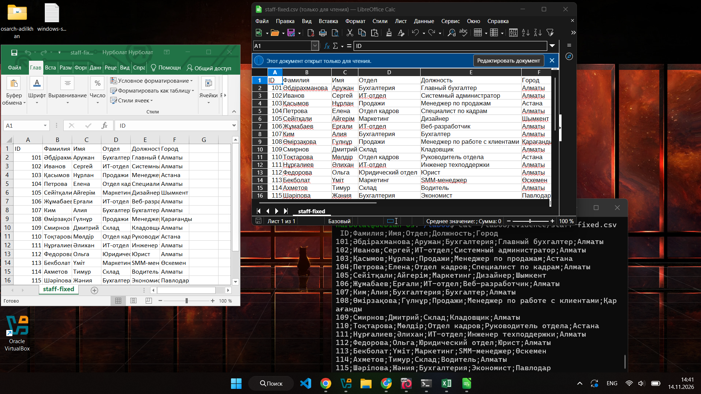

# Lab 5 — Encoding forensics

Name: Nurbolat Adilkhan · Date: 14.11.2026 · Tools: Debian guest over SSH (`file`, `xxd`, `iconv`), Windows host (Excel, LibreOffice Calc)

## What I received

`staff-broken.csv` is a staff list (15 people, columns `ID;Фамилия;Имя;Отдел;Должность;Город`) with Russian and Kazakh names. I kept the downloaded file unchanged as [evidence/staff-broken.csv](evidence/staff-broken.csv) (852 bytes) and never saved it from any program. Everything below was done on copies and on the output file.

## Diagnosis (made before the fix)

- **`file` said:** `Non-ISO extended-ASCII text, with CRLF line terminators` ([evidence/file-before.txt](evidence/file-before.txt)). That means one byte per letter, so a legacy code page; `file` cannot tell which one.
- **First 16 bytes:** `49 44 3b d4 e0 ec e8 eb e8 ff 3b c8 ec ff 3b ce` ([evidence/hexdump-before.txt](evidence/hexdump-before.txt)). `49 44 3b` is "ID;" and the header continues with single bytes per Cyrillic letter (for example `d4 e0 ec e8 eb e8 ff` = "Фамилия"). There are no two-byte pairs starting with `D0`/`D1` (so not UTF-8) and no `00` bytes (so not UTF-16).
- **Encoding: KZ-1048 (called `RK1048` in `iconv`).** Every letter is one byte, and I compared two code pages on the same file:
  - `iconv -f WINDOWS-1251` reads the Russian words correctly but breaks the Kazakh letters: `Јбдірахманова`, `Ќасымов`, `Нўрлан`.
  - `iconv -f RK1048` reads everything, Russian and Kazakh: `Әбдірахманова`, `Қасымов`, `Нұрлан`.
  
  The key byte is `a3`, which stands in front of "бдірахманова" in the first name (`101;a3 e1 e4 b3 f0 e0 …`): it is "Ј" in Windows-1251 but "Ә" in KZ-1048. Kazakh letters do not exist in Windows-1251, so a file that has them as single bytes must be in the Kazakh variant.
- **Line ending: CRLF (Windows).** The first line ends with `0d 0a` (offset 0x24 in the hex dump), and `file` says "with CRLF line terminators". The file has 16 lines with 16 CR and 16 LF.
- **BOM: none.** The file starts with `49 44` ("ID"), not with `EF BB BF` (UTF-8) or `FF FE` / `FE FF` (UTF-16).
- **Separator:** `;`.

## Decisions for the fixed file

- **UTF-8, with BOM.** Excel on Windows opens a UTF-8 CSV correctly only if the file starts with the BOM `EF BB BF`; without it Excel treats the file as an old code page and shows garbage. The brief says the file must open correctly everywhere, including Excel, so I added the BOM.
- **CRLF kept.** The original already has CRLF, which is what Windows and Excel expect, so I did not convert the line endings.
- **The price of these choices:** a Linux script that reads the first column name will see an invisible BOM in front of `ID` (`ID`), and CRLF can break a shell script (`$'\r': command not found`). If this file were used in a Linux pipeline, I would remove the BOM and convert to LF (`sed -i 's/\r$//'`).

## Fix

[scripts/fix.sh](scripts/fix.sh), run from the lab folder with `sh scripts/fix.sh`:

```sh
#!/bin/sh
# Lab 5: convert staff-broken.csv from KZ-1048 (RK1048) to UTF-8 with BOM, keep CRLF
in=evidence/staff-broken.csv
out=evidence/staff-fixed.csv
iconv -f RK1048 -t UTF-8 "$in" > "$out"
printf '\357\273\277' | cat - "$out" > "$out.tmp" && mv "$out.tmp" "$out"
```

The first `iconv` line converts the encoding (the Kazakh code page to UTF-8); the line endings stay CRLF. The second line puts the three BOM bytes `EF BB BF` in front of the file.

## Verification

[evidence/file-after.txt](evidence/file-after.txt):

```
$ file evidence/staff-fixed.csv
evidence/staff-fixed.csv: Unicode text, UTF-8 (with BOM) text, with CRLF line terminators

$ xxd evidence/staff-fixed.csv | head -n 4
00000000: efbb bf49 443b d0a4 d0b0 d0bc d0b8 d0bb  ...ID;..........
00000010: d0b8 d18f 3bd0 98d0 bcd1 8f3b d09e d182  ....;......;....
```

The file starts with `ef bb bf` (the BOM), and the Cyrillic letters are now two-byte UTF-8 pairs (`d0 a4 d0 b0` = "Фа"). `file` confirms UTF-8 with BOM and CRLF.

I opened `staff-fixed.csv` in three applications, side by side in one screenshot, [evidence/opens-correctly.png](evidence/opens-correctly.png): **Excel**, **LibreOffice Calc** and **`cat` in the Debian terminal**. In all three the names read correctly, each field is in its own column, and the Kazakh letters (Ә, Қ, Ұ, Ө, Ү, Ғ) are right, for example `Әбдірахманова`, `Қасымов`, `Нұрлан`, `Өмірзақова`, `Қарағанды`.



## What did not work the first time

1. **`scp` could not find the file.** I wanted to copy `staff-broken.csv` into the Debian guest and got `scp: stat local "staff-broken.csv": No such file or directory`. PowerShell was open in `C:\Users\Asus`, but the downloaded file was in `C:\Users\Asus\Downloads`. I ran the command again with the full path `"C:\Users\Asus\Downloads\staff-broken.csv"`.
2. **`xxd` was missing in the Debian guest.** The hex dump needs `xxd`, which is not installed in a basic Debian. I installed it with `sudo apt install -y xxd` before running the diagnosis.
3. **Windows-1251 looked right at first, but was wrong.** My first guess for a Cyrillic file was Windows-1251, and it did decode all Russian words. But the Kazakh names came out wrong (`Јбдірахманова`, `Ќасымов`, `Нўрлан`). I looked at the bytes of those names (`a3` for "Ә") and tried `RK1048`, in which every name was correct. So the first guess was a plausible but wrong code page, and only comparing the two outputs showed it.

## Evidence

- [evidence/staff-broken.csv](evidence/staff-broken.csv) — the original file, unchanged (852 bytes).
- [evidence/file-before.txt](evidence/file-before.txt) — `file` before the fix (extended ASCII, CRLF).
- [evidence/hexdump-before.txt](evidence/hexdump-before.txt) — the first bytes in hex (no BOM, one byte per letter, CRLF `0d 0a`).
- [scripts/fix.sh](scripts/fix.sh) — the conversion script.
- [evidence/staff-fixed.csv](evidence/staff-fixed.csv) — the fixed file (UTF-8 with BOM, CRLF).
- [evidence/file-after.txt](evidence/file-after.txt) — `file` and hex after the fix (UTF-8 with BOM).
- [evidence/opens-correctly.png](evidence/opens-correctly.png) — Excel, LibreOffice Calc and a terminal, all showing the names correctly.
