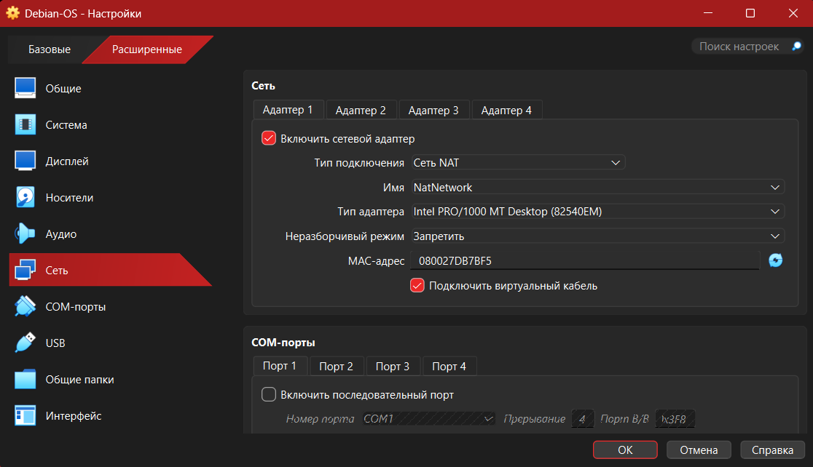
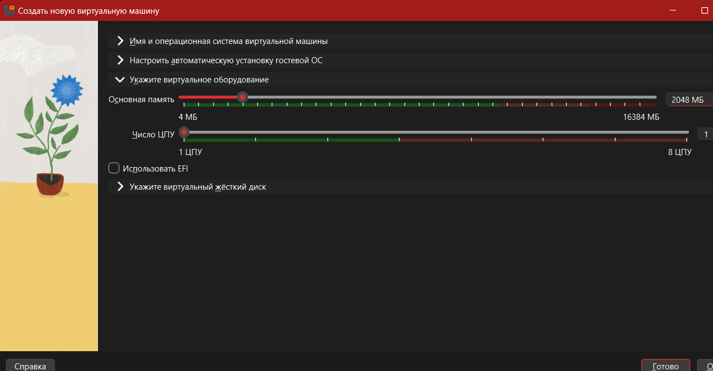

# Developer Test Environment: Virtual Machine Build Guide

This step-by-step document guides you through building an isolated, two-machine test computer environment (one Linux server, one Windows desktop) on your laptop. You do not need any prior IT experience to follow this guide.

---

## Prerequisites: What to Download First

Before opening any software, download the following three free and legal installers:

1. **VirtualBox 7.1 & Extension Pack**:
   - Go to: `https://www.virtualbox.org/wiki/Downloads`
   - Download **Windows hosts**.
   - Download the **VirtualBox Extension Pack** (under "All supported platforms").
   - *Why this choice:* VirtualBox is free and licensed under the PUEL / GPL for internal office evaluation. It allows running virtual computers safely inside Windows.

2. **Ubuntu Server 24.04 LTS (ISO file)**:
   - Go to: `https://ubuntu.com/download/server`
   - Download the LTS (Long Term Support) ISO file.
   - *Why this choice:* LTS versions receive 5 years of stability and security updates, making them the industry standard for backend servers.

3. **Windows 11 Enterprise Evaluation (ISO file)**:
   - Go to: `https://www.microsoft.com/en-us/evalcenter/evaluate-windows-11-enterprise`
   - Choose **Download the ISO**.
   - *Why this choice:* Microsoft provides official 90-day evaluation copies for developers. It is completely legal and does not require purchasing a product license key upfront.

---

## Step 1. Install Oracle VirtualBox

1. Double-click the downloaded VirtualBox installer `.exe` file.
2. Accept the default installation location and click **Next** through all prompts until you reach **Install**.
3. Once installed, double-click the **Extension Pack** file and click **Install** / **Agree** in the pop-up window.

> **Check:** Open VirtualBox from your Start Menu. A window titled *"Oracle VM VirtualBox Manager"* will appear.

---

## Step 2. Create the Shared Office Network ("NAT Network")

Before creating the machines, we must build a virtual cable between them.

1. In VirtualBox, click the **Tools** icon (top left) and select **Network**.
2. Click the **Create** button under the **NAT Networks** tab.
3. A new network called `NatNetwork` (or `DevNet`) appears. Ensure **Enable Network** and **Enable DHCP** are both checked.
4. Leave the IPv4 Prefix as `10.0.2.0/24`.

*Why this option and not default NAT or Bridged:*
- Default NAT puts each computer in its own isolated room; they cannot speak to each other.
- "Bridged" connects the virtual machine directly to our real office Wi-Fi, which often fails because corporate Wi-Fi blocks unknown devices by MAC address.
- **NAT Network** acts like a small private virtual office router: both virtual computers can talk to each other, and both can reach the internet safely using your laptop's connection.

---

## Step 3. Create the Linux Virtual Machine (Ubuntu Server)

1. Click **Machine** (in the top menu) → **New**.
2. Fill in the wizard:
   - **Name:** `dev-linux-server`
   - **Type:** Linux
   - **Version:** Ubuntu (64-bit)
   - **ISO Image:** Click the drop-down, choose **Other**, and select the Ubuntu Server ISO you downloaded.
   - Check the box **Skip Unattended Installation** (this ensures we configure our own clean administrative username).
   - Click **Next**.

3. **Hardware settings:**
   - **Base Memory:** Set to `2048 MB` (2 GB).
   - **Processors:** Set to `2 CPUs`.
   - Click **Next**.
   - *Why:* 2 GB of RAM and 2 CPUs give Ubuntu plenty of power for server testing while leaving over 13 GB of RAM for your laptop to run smoothly.

4. **Virtual Hard Disk:**
   - Choose **Create a Virtual Hard Disk Now**.
   - Set the size slider to `25.00 GB`.
   - Ensure the disk format is dynamically allocated (thin-provisioned).
   - Click **Next** and then **Finish**.

*Why dynamically allocated:* A dynamically allocated disk starts very small on your laptop (~2.5 GB) and only grows as the developer saves files, preventing your laptop drive from filling up.

5. **Attach to the Shared Network:**
   - Right-click `dev-linux-server` → **Settings** → **Network**.
   - Under **Attached to**, change `NAT` to **NAT Network**.
   - Ensure the name matches the network created in Step 2 (`NatNetwork`).
   - Click **OK**.

---

## Step 4. Install Ubuntu Server

1. Select `dev-linux-server` and click the green **Start** arrow.
2. In the console window, press `Enter` on **Try or Install Ubuntu Server**.
3. Choose **English** as the language.
4. When asked about network connections (`enp0s3`), verify that it displays an automatically assigned IP address like `10.0.2.x`. Press **Done**.
5. Keep default storage configuration (Use an entire disk) and select **Done** → **Continue**.
6. **Profile setup:**
   - Your name: `Developer`
   - Server's name: `dev-linux`
   - Pick a username: `devuser`
   - Choose a secure password and remember it.
7. Under SSH Setup: Check **Install OpenSSH server** (press Spacebar), then select **Done**.
8. Wait for the installation to finish, select **Reboot Now**, and press `Enter` if prompted to remove the installation medium.

> **Check:** Log in with `devuser` and your password. Run `ip -br a`. You should see an IP address like `10.0.2.3` next to `enp0s3` with the status `UP`.

---

## Step 5. Create the Windows 11 Virtual Machine

1. In VirtualBox Manager, click **Machine** → **New**.
2. Fill in the wizard:
   - **Name:** `dev-win-client`
   - **Type:** Microsoft Windows
   - **Version:** Windows 11 (64-bit)
   - **ISO Image:** Select the Windows 11 Enterprise Evaluation ISO.
   - Check **Skip Unattended Installation**. Click **Next**.

3. **Hardware settings:**
   - **Base Memory:** Set to `4096 MB` (4 GB).
   - **Processors:** Set to `2 CPUs`.
   - Ensure the **Enable EFI** box is **CHECKED**.
   - Click **Next**.
   - *Why:* Windows 11 enforces strict minimum requirements. It will refuse to install if given less than 4 GB of memory or if EFI firmware is disabled.

4. **Virtual Hard Disk:**
   - Set the size to `40.00 GB` (dynamically allocated). Click **Next** → **Finish**.

5. **Enable Virtual TPM 2.0:**
   - Right-click `dev-win-client` → **Settings** → **System**.
   - In the **Motherboard** tab, set **TPM Version** to **v2.0**.
   - *Why:* Windows 11 requires a Trusted Platform Module (TPM) security chip. VirtualBox can emulate this chip so you do not need special physical hardware.

6. **Attach to the Shared Network:**
   - Go to **Network** in Settings.
   - Change **Attached to** from `NAT` to **NAT Network** (`NatNetwork`). Click **OK**.

---

## Step 6. Install Windows 11 and Configure Firewall

1. Click **Start** on `dev-win-client`.
2. When the prompt *"Press any key to boot from CD or DVD"* appears, immediately click inside the window and press the spacebar.
3. Follow the Windows installer prompts (Language: English, Install Now).
4. Select custom installation, choose the 40 GB unallocated drive, and let Windows complete installation.
5. Create a local user account (e.g., `devuser`).

### Enable Ping on Windows (Crucial Step)
By default, Windows silently hides from all network ping tests. We must allow incoming pings so the developer can test connections:
1. Inside the Windows VM, click the Start menu, type `cmd`, right-click **Command Prompt**, and select **Run as administrator**.
2. Paste this command and press Enter:
   `netsh advfirewall firewall add rule name="Allow-ICMPv4-In" protocol=icmpv4:8,any dir=in action=allow`
3. Type `ipconfig` to note your Windows IPv4 address (e.g., `10.0.2.4`).

---

## Step 7. Verify the Network Connection

To prove both machines can reach the internet and communicate with each other:

1. **Inside the Ubuntu Linux terminal:**
   - Ping the internet:
     `ping -c 4 1.1.1.1` *(Must show `0% packet loss`)*.
   - Ping the Windows machine:
     `ping -c 4 10.0.2.4` *(Must show 4 replies from Windows)*.

2. **Inside the Windows Command Prompt:**
   - Ping the internet:
     `ping 1.1.1.1`
   - Ping the Linux machine:
     `ping 10.0.2.3`

> **Check:** Both machines receive continuous, successful replies with 0% dropped packets.

---

## Step 8. Take a Clean Baseline Snapshot (The "Safety Net")

This step delivers the promise to let the developer *"try things without breaking anything"*.

1. Inside each virtual machine, shut it down cleanly:
   - On Linux: `sudo poweroff`
   - On Windows: Start menu → Power → Shut Down.
2. In VirtualBox Manager, click the menu button next to `dev-linux-server` and select **Snapshots** (or press `Ctrl + Shift + S`).
3. Click the **Take** button (camera icon).
4. Name the snapshot `clean-install` and description: *"Fresh OS install with verified network connectivity"*.
5. Repeat the exact same snapshot process for `dev-win-client`.

### How to Roll Back When the Developer Breaks Something
If the developer damages system files, catches malware, or misconfigures network drivers:
1. Power off the virtual machine in VirtualBox.
2. Go to **Snapshots**.
3. Click on `clean-install` and click **Restore**.
4. Uncheck *"Create a snapshot of the current machine state"* and click **Restore**.
5. Start the VM. It will boot up in seconds, completely restored to pristine factory condition.

---

## Troubleshooting: What to Do When Something Goes Wrong

1. **Windows says: "This PC can't run Windows 11" during setup.**
   - *Fix:* Power off the VM. Open Settings → System. Make sure **Enable EFI** is checked and **TPM** is set to **v2.0**.
2. **Linux ping to Windows times out, but Windows can ping Linux.**
   - *Fix:* The Windows Firewall rule was missed. In Windows, re-run Step 6's `netsh` command in an Administrator Command Prompt.
3. **The virtual machines cannot reach the internet.**
   - *Fix:* In VirtualBox, go to Tools → Network → NAT Networks. Make sure your network (`NatNetwork`) has the **Enable Network** box checked and that your host laptop has an active internet connection.
